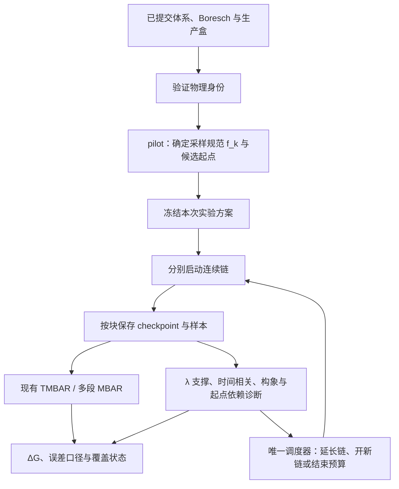

# Stage 2 准确性设计：连续链、采样身份与构象覆盖

## 0. 状态与目标

**2026-10-03：设计提案，未实施、未做真机验证。**
依据：[当日代码复查](../archive/CODE_REVIEW_2026-10-03_accuracy.md)。
本轮只新增本文及索引；不改变现有生产算法、配置、采样预算或缓存。

建议保留 IBS 的 λ 混合与现有多段 MBAR。工程上先堵住协议/盒身份、时间步长和
f_k 规范缺口；采样上试验少量连续长链；证据上分别回答 λ 态是否有支撑、蛋白/配体
构象是否存在起点依赖。现有 LCR 的 λ 分配功能可以保留。

这是一种降低可识别采样风险的设计，不能保证有限轨迹覆盖所有未知构象盆地。
HREX / 局部 tempering 只列为实验后备，不在第一期恢复此前暂停的增强采样路线。

## 1. 总体数据流



诊断模块只返回证据。调度仍由一处控制器负责，避免恢复旧控制器与 LCR 两套并行决策。
方法比较先用预注册固定预算，避免通过观察最终 ΔG 选择停止时刻或采样方案。

## 2. 最先落地的正确性修复

### 2.1 三类身份，分别控制复用

复用现有 `_stage_window_sampling_identity` 的筛选语义，补齐明确缺失的字段。

| 对象 | 内容 | 变化后的行为 |
|---|---|---|
| `physical_id` | 同腿目标哈密顿量：体系/拓扑语义、配体、温度、约束/质量、Boresch、softcore、离子处理、目标尾项约定、已提交生产盒矩阵 | 不能混用旧采样；不同物理目标另开记录 |
| `sampling_epoch_id` | physical_id + 窗口 λ 列表 + 冻结 f_k 的采样规范 + 实际残差势身份 + 积分器/步长/约束容差 | checkpoint 原位续算要求完全一致；可分析的不同偏置 epoch 按各自采样分布处理 |
| `analysis_id` | 输入帧集合/已提交块、估计量版本、去相关与误差规则、诊断/报告阈值 | 重分析样本，不因此重跑 MD |

f_k 变化不改变 physical_id，但改变 sampling_epoch_id。补采长度不改变已生成样本身份，
实际完成量单独校验。结构特征、标签阈值、进度历史不进哈密顿量身份。
数据文件哈希继续负责完整性；不新增“整个仓库源码哈希”。

**生产盒取已提交状态中的完整 3×3 矩阵，单位 nm。** 体积相同但形状不同也不能默认复用。
矩阵在统一单位/表示后按严格容差比较，不拿每次重建产生的坐标哈希当缓存身份。
此阶段限定固定盒 NVT 的 Stage 2；NPT 的逐帧体积与 reduced-potential 契约另立方案。

校验入口统一：LCR 账本、逐段 loader、合并 loader、stage/final 早退、analyze-only。
旧账本只有在其真实产物证明同一身份时才能重建索引；缺关键证据时标未验证，不能补写
当前身份后直接复用。新契约只作用于相应阶段，避免无关 Stage 1 轨迹被全部作废。

### 2.2 固定 f_k 的两种能量规范

证据返回两个显式字段：

```python
sampling_f_k_kJ   # 从 sampling_states 解；给偏置中心与 pilot 信赖域
target_f_k_kJ     # 从目标能量解；给物理 ΔF、目标权重与报告
```

两者在同一批帧、同一多采样态分母上求解；不重写 MBAR。
固定盒 baseline 若尾项确为逐态常数，可用经过校验的常数差换算；通用路径直接另算
采样口径。残差臂不可假定差值为常数。
保持现有 `merged_f_k_kJ` 的旧含义作兼容报告，调度器改读新采样字段，记录规范版本。

### 2.3 时间用物理时长声明

新增拟议配置 `stage2_equilibration_ps`、`stage2_equilibration_block_ps`。
老 `stage2_lcr_burn_in_steps` 仍可读，但同时出现两套配置时拒绝歧义。
迁移时将旧步数明确换算为当前实际时长；不能静默把旧 25 ps 加长为 50 ps。

初始化爬坡可保持 1 fs；进入正式平衡段前显式选择并记录生产步长。
新起与 resume 都读同一阶段时间计划。最后一块只跑剩余步数，0 时跳过，负值报错。
实际累计时间由成功接受的积分 chunk 的 `steps × dt` 相加；回滚或降步长需要记录，
不能继续按名义 2 fs 推算时长。尝试过但回滚的计算另计成本。
不整除的时长按明示规则取整，并报告 requested/actual/dt，误差不超过一个积分步。

## 3. 采样单元改为连续链

### 3.1 链、epoch 和保存块不能混为独立样本

```python
ChainRecord = {
    "root_id": "独立准备来源或共同祖先组",
    "chain_id": "连续轨迹编号",
    "epoch_id": "当前固定采样势编号",
    "start_source": {"path": "...", "frame": 0, "preparation_id": "..."},
    "physical_id": "...",
    "sampling_epoch_id": "...",
    "completed_steps": 0,
    "completed_time_ps": 0.0,
    "checkpoint": "...",
    "committed_blocks": [],
}
```

同一链每隔固定时长保存一个 block。补时长时恢复完整 checkpoint 的坐标、速度、
盒子和 RNG，继续同一固定势；不重新最小化、不重复 bias ramp、不重新随机落盆。
一个链保存十次，仍是一条链。当前只接力坐标的 `stage2_lcr_relay` 不承担这个新语义。

跨平台无法恢复原生 checkpoint 时，可以走显式的 portable restart，但记录连续性
中断和新热化区间，保留原 ancestry；不能把它计成新的独立构象证据。

f_k 改变时新建 epoch，执行新势下的平衡并保存各 epoch 的全部有效样本。
不同 epoch 合并复用 `multi_segment_analysis`，交叉采样能量在最终选定帧集上重建。
仅在目标相同、所有帧的交叉采样势可精确求值时允许合并。现有共同残差模型的约束保留；
不能换模型后仍用旧 `sampling_states` 假装完成交叉求值。

### 3.2 多起点是检验起点依赖，不是制造盆地权重

优先从已有合格预平衡轨迹中选择结构上不同的快照；缺少替代态时明确记“只有一个起点族”。
不同快照若来自同一条未充分混合的预平衡链，仍共享 root 来源，不能自动叫独立。
需要跨 root 证据时才增加独立准备，成本进入完整 workflow 预算。

所有候选起点使用同一物理体系、盒和 committed Boresch 参数；在实际采样势下热化后
开始生产。原始初始快照不直接加入 MBAR。人为选来的多个盆地不按 50/50 等权重合并。
如果各链困在不同盆地且没有混合，盆地间平衡权重仍未知；最终结果保留 unresolved 状态。

### 3.3 少量连续长链是否划算，先作同预算比较

第一轮在相同窗口/采样势上比较 `3 × 0.5 ns` 重启与 `1 × 1.5 ns` 连续。
这是分配方式的诊断实验，后者只有一条链，不构成独立重复证据，也不是推荐生产时长。
原 LCR 的三种 tilt 与原接力路线可另作参照，不能把 f_k 与起点同时改变后归因于连续性。

若连续性确有收益，再比较 `3 × 1 ns` 短链与 `2 × 1.5 ns` 连续链等总积分预算方案。
独立 root 准备、热化、pilot、编译/Context 和分析 I/O 的成本全部单列；另报告同墙钟
预算表现。不能只比较生产步数或把 1–2 ns 当作已验证的充分采样长度。

## 4. 证据分别描述 λ 支撑与构象行为

| 证据 | 来源 | 回答的问题 |
|---|---|---|
| λ 支撑 | 现有目标权重 ESS、top-1%、相邻重叠、sampling 占据 | 哪个炼金态缺有效支撑？ |
| 时间相关 | 权重/Δu 与已定义结构特征的时间序列 | 保存多少帧才相当于足够独立的观测？ |
| 构象行为 | 连续链的盆地占据、往返、分块 ΔF、起点族间差异 | 是否仍有慢模态或起点依赖？ |

结构特征以可迁移的局部几何为主：配体到关键侧链的最小重原子距离、口袋侧链
sin/cos χ1、口袋开闭距离、配体关键扭转；水数只在有对应样本时使用。
特征与 atom/residue mapping、阈值、观测 cadence 写入 schema。HSP90 特定残基不写进
通用引擎；按体系显式配置或由 pilot 选择，正式比较前冻结。

沿用 `abfe_core.minimum_image_displacement_nm` 的三斜盒处理，使用局部口袋/受体锚点
参考系。现有 `stage2_basin_features.py` 可提供特征思路，但不能原样接入生产：它的盒处理
使用对角长度、温度固定 300 K，且当前输出偏段均值，缺少上述通用时间序列契约。

坐标旁车按时间/能量帧索引匹配。粗采样结构特征的相关时间必须换算为 ps，再用于
能量样本的块长/抽帧计划，不能直接把粗 cadence 的 g 当成能量帧的 g。
有限序列不够长或观测特征方差为零时，相关时间可能不可估；不把它写成“慢模态不存在”。

拟议结果字段：

```python
sampling_assessment = {
    "lambda_support": "adequate | inadequate | unmeasured",
    "configuration": "unresolved | start_dependent | mixing_observed",
    "precision": "estimated | insufficient",
    "root_groups": [],
    "reason_codes": [],
}
```

`mixing_observed` 只描述预先定义特征上观测到的混合，不表示所有未知盆地都被覆盖。
现有 `CONVERGED` 标签可兼容保留，但报告同时附带此证据，不能升级成全局平衡证明。

## 5. 误差与调度规则

保留现有 TMBAR/多段 MBAR 主估计量与去相关流程。PyMBAR 的平衡样本和独立性条件
需满足，权重 ESS 不替代时间去相关：[官方 MBAR 文档](https://pymbar.readthedocs.io/en/master/mbar.html)。

初期分别报告 MBAR 去相关误差、连续链分块敏感性、独立 root 的结果散布和起点依赖。
不能将所有量随意平方和，也不能把两个 root 的散布当作精确的 95% 覆盖保证。
链间删一法的单位是具有可解释独立性的 root/链；相关保存块不充当独立段。
同一 root 的多个窗口/链有相关性时，删 root 要重解整条腿，不能只独立放大各窗 σ。
块长/帧选择变化后重新做采样态塌缩，不切片复用旧混合分母。

调度器每次只执行一个已有证据支持的动作：

| 观测 | 动作 |
|---|---|
| λ 支撑弱，结构尚未见起点依赖 | 从采样规范重定下一 epoch 的 f_k；现有信赖域逻辑可复用 |
| 分块持续漂移，或已知慢特征只有少数转换 | 在原 epoch 继续当前链；固定预算结束时保留未解决状态 |
| 不同起点族给出不同结果 | 延长已有链，按预注册计划补独立来源；不取平均掩盖差异 |
| λ 支撑、观测混合、精度均有足够证据 | 按事先约定的预算完成并报告；不按实验亲和力选择停止 |
| 剩余预算不足 | 明确停止并报告未解决项，不丢掉较差的段或换低要求标签 |

结构诊断第一期只报告，不自动触发大规模新计算。科学标签的迁移单独版本化，避免
一次修代码顺带替用户改完整预算与科学接受规则。

## 6. 模块和交付顺序

以下模块均为**拟新增/拟调整**，不是当前实现：

| 阶段 | 模块 / 接线 | 完成判据 |
|---|---|---|
| M0：修正确性 | 小模块 `stage2_sampling_contract.py`；现有 ledger/loader/final/analyze 共同调用；修 sampling f_k、burn-in、source_window_index | 温度/Boresch/盒身份失配拒用；改变分析阈值只重分析；尾项常数不移动 sampling 中心；步数/时长精确 |
| M1：连续推进 | `ibs_engine.run_all_windows` 的显式 continue 接口；pipeline 记录 chain/epoch/block | 分块续算与单次连续运行同参数/状态；不重复最小化；中断/损坏块不能重复计帧；portable restart 有连续性标记 |
| M2：只读结构证据 | `stage2_structure_evidence.py`；扩展坐标旁车；schema 进入 analysis 身份 | 温度/三斜盒/原子映射正确；无转换、跨盆与起点依赖玩具例输出不同状态 |
| M3：有限真机 A/B | 先针对交接中记录有问题的 HSP90 L3/L27，再加一个稳定对照和柔性配体溶剂腿 | 同输入同预算比较；不依据实验 ΔG 调参；公布未解决的构象差异与完整成本 |
| M4：决定是否升级采样 | 评估连续链收益，必要时另立交换/局部 tempering 方案 | 能说明剩余瓶颈及收益，之后才接增强采样；本提案不启动此阶段 |

核心验证场景：

1. 同 λ 布局、温度/约束/Boresch 改变，账本不能复用；盒体积相同但矩阵改变也要识别。
2. 换报告阈值、增加目标生产时长，已有兼容帧仍可用，缺的步骤准确续算。
3. `target = sampling + c_k`，目标 ΔF 随常数变，sampling 中心保持不变。
4. 7000/1000/0 步、非整数 ps、resume、回滚降步长，计划时间与实际账本对齐。
5. 同 basin 的多短段不能报告构象已解决；双起点但各不换盆仍 unresolved；
   有多次往返且足够长的已知玩具模型才恢复精确 ΔF 与可检验的误差覆盖。
6. checkpoint 恢复前后全局参数和 RNG 连续；换 f_k 创建新 epoch；块提交失败不产生
   部分“完成”样本。CPU 的确定性检查与 GPU 的容差/重启检查分别验收。

M0 是首先可以实施的小范围修复。M1/M2 作为新模式实验，通过 M3 后再考虑替换生产默认。

## 7. 增强采样后备的边界

如果主要困难是窗口互通，可研究相邻 IBS 混合窗口之间交换，接近
[REXEE 原论文](https://arxiv.org/abs/2308.06938)讨论的重叠 expanded ensembles 交换。
对于同温固定盒，接受率必须来自两个**完整实际采样势**的交叉能量：

`p_accept = min(1, exp[-u_a(x_b)-u_b(x_a)+u_a(x_a)+u_b(x_b)])`。

包括实际偏置与残差项；不能用分析侧加了尾项的目标能量替代。每轮接受后记录样本
当前采样态和 ancestry。它是新的采样协议，原来的独立链 σ 也需按交换后的相关性重审。

如果蛋白慢模态与 λ 弱相关，窗口交换未必能跨越蛋白势垒；这种风险也是
[alchemical metadynamics 原论文](https://arxiv.org/abs/2206.01329)讨论的动机。
局部 tempering / 定义良好的构象增强势才可能更对症，但要新增 Hamiltonian、
交叉能量和物理端点重加权验证，应单独试验。不能把“开启 HREX”当作准确性的保证。
